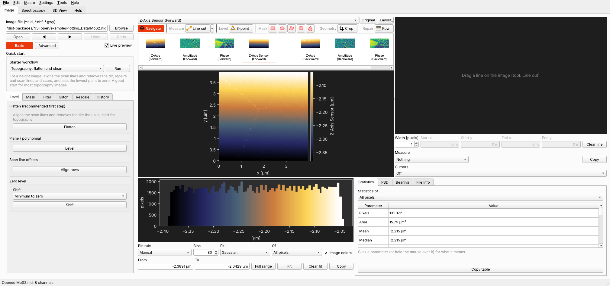
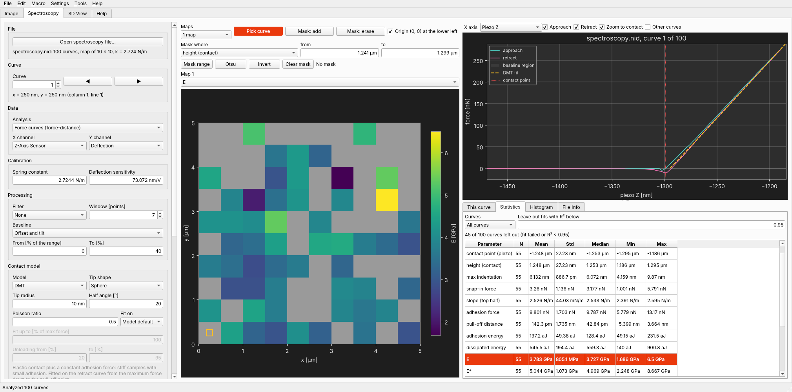

# NSSA: NSF Surface and Spectroscopy Analyzer

Processing and analysis of AFM images and force spectroscopy from Nanosurf instruments (`.nid`, `.nhf`, and `.gwy`
files), in one Windows program or from Python.

**[Download the latest version](../../releases/latest)**: `NSSA-Setup-<version>.exe` installs it (no administrator
rights needed); the `.zip` is the same program to unpack and run without installing. Windows may warn about an unknown
publisher, because the program is not code-signed: choose *More info*, then *Run anyway*.

An independent side project, not a product of Nanosurf AG. Nanosurf's file formats are read with
[NSFopen](https://pypi.org/project/NSFopen/), which also does the calculations, so a Python script and the program give
the same numbers.



## What it does

- **Images:** leveling (flatten, polynomial, facets, three points), masks, filters, glitch and scar repair, rescaling,
  statistics after ISO 25178, line cuts with step heights, critical dimension and ISO 21920 roughness, PSD fits, grain
  analysis, lattice measurement, curvature (radii, bow), terrace analysis with step heights, stitching, channel
  arithmetic and a 3D view.
- **Spectroscopy:** force curves and force maps fitted with Hertz, Sneddon, DMT, JKR or Oliver-Pharr for five tip
  shapes, maps of modulus and adhesion (also on the topography in 3D), masks, different models on different regions,
  a quality filter, histograms with fits, and I-V curves.
- **Repeatable:** every step can be undone, saved as a macro and run on a folder of files (also from the command line).
- **Reports and export:** PDF and PowerPoint reports, PNG, CSV and Gwyddion files.
- **Color maps:** built-in maps with previews, and an editor to make your own.

*File - Open example* opens NSFopen's example files, so everything can be tried without your own data. The user manual
is `app_NSSA/MANUAL.md`, also on the Help page of the program (F1).



## Running from the source code

Needs Python 3.10 or newer and NSFopen 2.5.0 or newer, which `requirements.txt` installs:

```
pip install -r requirements.txt
python app_NSSA/main.py [image file]
python app_NSSA/main.py --batch macro.json <files or folders> --out <folder> [--grains]
python app_NSSA/main.py --spectroscopy settings.json <files or folders> --out <folder>
python -m pytest tests
```

The tests use NSFopen's example files; tests that need other example data skip when it is missing.

## Stand-alone program (Windows)

`packaging/build.bat` builds a program that needs no Python: run it on a Windows PC with Python 3.10 or newer on the
PATH. It makes its own virtual environment with only the packages of `packaging/requirements-build.txt`, kept
with the temporary build files in `%LOCALAPPDATA%\NSSA\Build` (outside the project folder: a synced folder such as Dropbox
locks files while pip and PyInstaller write them and breaks the build), runs PyInstaller with `packaging/NSSA.spec`, checks the result
with `--selftest`, and, if Inno Setup 6 is installed, makes an installer with `packaging/installer.iss`.

| Result | |
|---|---|
| `packaging/dist/NSSA/` | the program folder; copy it anywhere and start `NSSA.exe` |
| `.../NSSA-batch.exe` | batch processing in a console, same options as `main.py --batch` |
| `packaging/Output/NSSA-Setup-<version>.exe` | installer: per-user (no admin rights), Start menu, uninstaller, optional desktop shortcut and .nid / .nhf / .gwy association |

The version is `VERSION` in `app_NSSA/appinfo.py` (also in the .exe file properties and *Help - About*). The first
build leaves out the optional packages (python-pptx, nanosurf); to add one, take it out of
`EXCLUDES` in the spec and add it to `requirements-build.txt`. No Gwyddion files are distributed (GPL): the color maps
are NSFopen's own tables. Not signed: Windows SmartScreen warns about an unknown publisher
on the first start until the .exe and the installer are signed with a code signing certificate.

## Modules

| Module | Content |
|---|---|
| `imgdata.py` | readers for `.nid` (own), `.nhf` (Nanosurf's `nanosurf.utils.io.nhf_reader` if installed, else own h5py reader) and `.gwy` -> `Channel` |
| `ops.py` | all operations (level, mask, filter, glitch, rescale, geometry) as functions of a `State`, registered by name: **NSFopen's** `NSFopen.process.ops` (this file only points `import ops` there) |
| `pipeline.py` | history with undo, `Document` (one pipeline per channel, journal of all steps, switch of the lateral scale), macros (JSON) |
| `lateral.py` | nominal (open loop) or X/Y position sensor based lateral scale: scale-only and resampling corrections |
| `measure.py` | statistics, line profile, critical dimension, PSD, 2D spectrum, ACF / HHCF, Sal / Str / Std, bearing curve, lattice vectors: NSFopen's `NSFopen.process.measure`, plus the CD / step tables and the measurement chosen under a profile |
| `lattice_dialog.py` | Tools - Measure lattice: ACF with the vectors a, b; click to pick |
| `fitting.py` | fits to histograms: Gaussians, Lorentzian, pseudo-Voigt (NSFopen's `NSFopen.process.fitting`) |
| `colormap_editor.py` | color map previews (menu icons and hover strips) and the color map editor (anchors, histogram, preview) |
| `colormaps.py` | color maps: NSFopen's Nanosurf maps (Sky, the height default, and 11 more), older names, the user's gradient files in `colormaps/` |
| `workflows.py` | starter workflows (steps + what to show afterwards) for the Quick start box |
| `psdfit.py` | fits to the radial PSD: ABC + noise floor, ABC, two power laws; corner, noise floor, effective resolution (NSFopen's `NSFopen.process.psdfit`) |
| `combine.py` | arithmetic of two channels with a sub-pixel shift (lateral force from the forward / backward friction channels), shift by cross-correlation: NSFopen's `NSFopen.process.combine`, plus the default channel name |
| `grains.py` | grain analysis of the mask: labeling, watershed split, per-grain parameters: NSFopen's `NSFopen.process.grains`, plus the CSV rows and display units |
| `stitch.py` | stitching: placement by scan positions, masked cross-correlation registration, height matching, blending |
| `export.py`, `batch.py` | PNG / CSV / Gwyddion export, batch processing |
| `surface3d.py`, `view3d.py` | 3D view: mesh, camera, materials (no GL) and the OpenGL 3.3 renderer with its controls |
| `profile_iso.py` | roughness and waviness of line profiles (ISO 21920, Gaussian filter ISO 16610-21): NSFopen's `NSFopen.process.profile_iso`, plus the parameter table |
| `spectroscopy.py` | spectroscopy files (.nid / .nhf with NSFopen): force curves, force maps, filter, baseline (offset, tilt, interference sine), contact point, adhesion and energies, results of all curves, statistics, maps |
| `contact.py` | contact mechanics: sphere, cone, pyramid, cylinder punch, hyperboloid; Hertz, Sneddon, DMT, JKR and Oliver-Pharr fits |
| `iv.py` | I-V curves: dI/dV, normalized conductance, zero-bias conductance, gap, rectification |
| `spec_view.py` | the Spectroscopy page (between Image and 3D View) |
| `spec_maps.py` | the map area of the Spectroscopy page: 1-4 maps, pick and mask tools, curves on the topography |
| `spec_maps_image.py` | result maps put onto the topography by position (3D view) |
| `spec_report.py` | PDF and PowerPoint report of the Spectroscopy page |
| `spec_batch.py` | spectroscopy settings files and the folder batch (also `main.py --spectroscopy`) |
| `report.py` | the PDF report (matplotlib pages, no GUI): content per channel, page layout |
| `report_pptx.py` | the same report as PowerPoint slides (python-pptx, optional) |
| `plots.py`, `panels.py`, `grain_view.py`, `channel_strip.py`, `report_dialog.py`, `stitch_dialog.py`, `combine_dialog.py`, `lattice_dialog.py`, `icons.py`, `main_window.py` | the GUI (PySide6, matplotlib); `icons.py` draws the tool icons |
| `widgets.py`, `plot_style.py` | input widgets, the dark and light look of the graphs |

The computations (operations, measurements, fits, grains, ISO profile analysis, channel arithmetic) are NSFopen's
(`NSFopen.process`, NSFopen >= 2.5.0), so scripts and the app give the same numbers; the app's files of the same names
re-export them and add only display helpers. `pipeline.py` and `imgdata.py` contain no GUI code either. A new operation
is one function with the `@_op("group.name", "Label", **defaults)` decorator in NSFopen's `process/ops.py` plus a button
in `panels.py`; macros, undo and batch work automatically. `tests/gui_smoke.py` and `tests/gui_panels.py` write screenshots of the window for a visual check.
